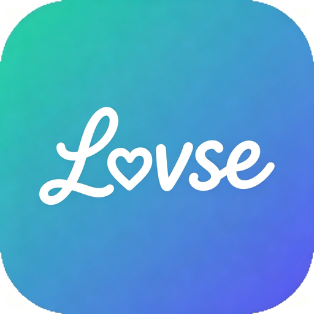

<div align="center">



# losve-tab

**A tablet home screen for the elderly: big, crisp, obvious and simple — without giving up beauty.**

A landscape tablet launcher based on [Aerial](https://github.com/pengchujin/aerial-tv). No ads, no recommendation feed, no remote control — just the apps your family uses every day, a wallpaper, and a quiet aerial screensaver.

[中文](README.md) · **English**


</div>

## Why this exists

When an older family member uses a tablet, the usual fix is to go into Settings and crank up both the font size and the icon size. It usually backfires:

- App names get cut off — "WeC…", "Setti…" — and nobody can tell which icon is which;
- Bigger and bigger icons with broken spacing mean only a few apps fit on a screen, so you keep swiping pages;
- Forced scaling throws the layout off, leaving ugly gaps and a heavy, cluttered look;
- Recommendations, ads and badges from the stock launcher mix in, so opening one simple app takes several taps.

**losve-tab started from one goal: give the elderly at home a home screen that is bigger, clearer, obvious at a glance, genuinely simple, and still pleasant to look at.** It is not a TV launcher squeezed onto a tablet, and not a brute-force system font scale. The layout itself was redone: tiles large enough to read, full app names, the everyday apps up front, and soft colours with clear contrast. Pick up the tablet and the right app is already in view — no learning curve, no asking someone for help.

## How it works on a tablet

| Action | Result |
|:---:|:---|
| **Tap** an app icon | Opens the app straight away |
| **Long-press** an app icon | Menu: uninstall, rename, add to folder, move |
| Pick **Move**, then press and drag | The icon follows your finger; release to drop it |
| Tap a folder | Opens directly; long-press and move work inside too |
| Tap **Personalize** at the top right | Wallpaper, screensaver, layout, weather, performance |
| **Open settings page** on the right of Personalize | Opens the local setup page in the tablet's browser for on-device arranging |

Landscape orientation, touch targets of 48dp or more, and no focus rings or zoom animations — every interaction is built for a finger, with no remote control required.

## What is kept

- **Aerial screensaver**: Apple TV aerial films, plus your own photos, a clock and local videos.
- **Video wallpaper & wallpaper downloads**: Bing daily image, built-in wallpapers, photos and videos pushed from the setup page.
- **Clock & weather**: on-screen clock and weather, with the city configurable in Personalize.
- **Web arranging**: open the local page in the tablet browser to rename, change icons, sort and group apps.
- **Performance switches** (all under Personalize → Performance):
  - Cap video at 1080P / 30fps / SDR (HDR off);
  - Automatically lower the bitrate when playback stutters;
  - Glass blur at High / Low / Off;
  - Reduce animations to cut overdraw.

Tuned for tablets, including Mali-G57-class GPUs: a single glass layer, 1080P SDR video and reduced animation by default.

## What changed from the original

- Turned off the global TV focus navigation: focus rings, focus scaling and D-pad routing are gone, replaced by pure touch tap / long-press.
- Long-press opens the menu immediately; dragging is enabled only after choosing "Move", with a white ring for feedback and finger-accurate tracking; folders behave the same way.
- Removed HDMI inputs, CEC, boot-to-source and other TV-only UI, along with the home guard and ADB keep-alive.
- Removed the software updater and the QR code; the setup page is now a button that opens directly on the device.
- Grouped the performance switches under Personalize; completed the Chinese, English, Russian, Ukrainian and Kazakh translations.

## Install

Copy `losve-tab-v1.0.0-release.apk` to the tablet and tap to install, or run on a computer:

```bash
adb install -r losve-tab-v1.0.0-release.apk
```

If Android asks about "unknown sources", allow that install source in Settings. To make it the default launcher, press Home after installing, pick losve-tab in the chooser and set it as default.

> This release is signed with the Android Debug certificate, which is convenient for sideloading and debugging. For an official release, prepare your own keystore and re-sign the APK.

## Credits

This launcher stands entirely on the shoulders of the original author.

- Thanks to **pengchujin** for open-sourcing [Aerial (aerial-tv)](https://github.com/pengchujin/aerial-tv): a clean, restrained Android TV launcher with real attention to detail. Most of this project — the architecture, aerial screensaver, wallpapers, clock and weather, and web arranging — comes from that work.
- Thanks to everyone who contributed to Aerial, reported device quirks in the issues, and drew the 16:9 tile artwork.
- losve-tab only adapts it for older family members using a tablet. The upstream license and attribution are preserved here.

## License

This project keeps the upstream [Aerial](https://github.com/pengchujin/aerial-tv) MIT License — see [LICENSE](LICENSE).
