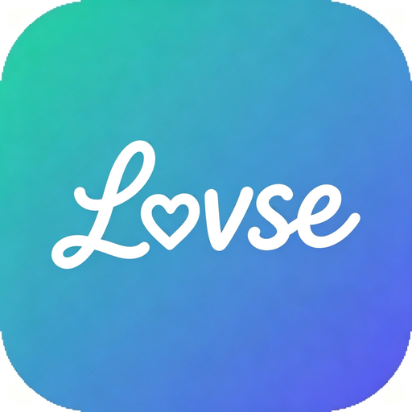

<div align="center">



# losve-tab

**给长辈用的平板桌面：字大、图大、一眼看懂，但不将就美观。**

基于 [Aerial](https://github.com/pengchujin/aerial-tv) 改造的横屏平板桌面。没有广告，没有推荐流，没有遥控器——只有家人日常要用的 App、一张壁纸和一段安静的航拍屏保。

**中文** · [English](README.en.md)


</div>

## 为什么做这个

家里长辈用平板，最常见的做法是进系统设置里把字体和图标一并调大。结果往往事与愿违：

- 应用名称被截断成「微信…」「设置…」，长辈分不清哪个是哪个；
- 图标越放越大、间距失衡，一屏放不下几个 App，反而不停地翻页；
- 强行放大后排版错位、留白难看，界面显得笨重又杂乱；
- 系统桌面的推荐、广告和角标混在中间，找个简单的应用要好几次点击。

**losve-tab 的初衷，就是让长辈在平板上有一个更大、更清晰、一目了然、更简单、同时不失美观的桌面。** 不是把 TV 桌面硬塞进平板，也不是靠系统设置粗暴放大，而是从布局本身重新安排：磁贴足够大、名称完整显示、常用的一排放眼前、颜色柔和对比清晰。长辈拿到平板，抬眼就能找到要用的东西，不需要学习，也不需要别人帮忙。

## 它在平板上怎么用

| 操作 | 结果 |
|:---:|:---|
| **轻点** App 图标 | 直接打开应用 |
| **长按** App 图标 | 弹出菜单：卸载、改名、加入文件夹、移动 |
| 菜单里选 **移动**，再按住拖动 | 图标跟手移动，放到想要的位置松手 |
| 点击文件夹 | 直接打开，里面同样可以长按、移动 |
| 点右上角 **个性化** | 壁纸、屏保、布局、天气、性能设置 |
| 个性化右侧 **打开整理设置** | 用平板自带浏览器打开本机设置网页，直接在平板上整理 |

横屏方向、48dp 以上的触摸热区、没有焦点框和缩放动画——所有交互都为手指设计，不再需要遥控器。

## 保留的能力

- **航拍屏保**：Apple TV 的航拍影片；也支持自己的照片、时钟和本地视频。
- **视频壁纸与壁纸下载**：必应每日壁纸、内置壁纸、从设置网页推送的照片和视频。
- **时钟天气**：桌面时钟与天气，可在个性化里设置城市。
- **网页整理**：平板浏览器打开本机页面，直接改名、换图标、排序、分组。
- **性能开关**（都在「个性化 → 性能」里）：
  - 视频限制 1080P / 30fps / 关闭 HDR；
  - 播放卡顿时自动降低码率；
  - 毛玻璃虚化 高 / 低 / 关闭；
  - 降低动画，减少过度绘制。

针对平板（含 Mali-G57 一类 GPU）做了降载，默认使用单层玻璃、1080P SDR 视频和低动画。

## 相比原版的改动

- 关闭 TV 全局焦点导航：移除焦点框、焦点缩放和方向键路由，改为纯触屏点击 / 长按。
- 长按直接弹菜单；「移动」后才进入可拖动状态，拖动跟手、有白环反馈；文件夹内同样支持。
- 移除 HDMI 信号源、CEC、开机进信号源等平板用不到的 UI；移除主页守护和 ADB 保活。
- 移除软件更新功能与二维码；设置网页改为按钮，可直接在本机浏览器打开。
- 性能开关集中到「个性化」；补齐中、英、俄、乌、哈五种语言的文案。

## 安装

把 `losve-tab-v1.0.0-release.apk` 拷到平板上点击安装；或在电脑上执行：

```bash
adb install -r losve-tab-v1.0.0-release.apk
```

首次安装若提示「未知来源」，请在系统设置中允许该安装来源。若想把它设为默认桌面，安装后按 Home 键，在弹出的一览中选择 losve-tab 并设为默认。

> 当前 release 包使用 Android Debug 证书签名，便于自行安装和调试；如需正式发布，请自行准备 keystore 重新签名。

## 致谢

这个桌面能做成，完全站在原作者的肩上。

- 感谢 **pengchujin** 开源 [Aerial（aerial-tv）](https://github.com/pengchujin/aerial-tv)：一个干净、克制、把细节做到位的 Android TV 桌面。本项目的主体架构、航拍屏保、壁纸、时钟天气、网页整理等绝大部分能力都来自该项目。
- 感谢 Aerial 的各位贡献者和在 issue 里提供机型信息与反馈的朋友，以及图标原作者绘制的 16:9 磁贴素材。
- losve-tab 只是把它改造给家中长辈在平板上使用；原项目的许可证与署名在此一并保留。

## 许可证

本项目沿用上游 [Aerial](https://github.com/pengchujin/aerial-tv) 的 MIT License，详见 [LICENSE](LICENSE)。
